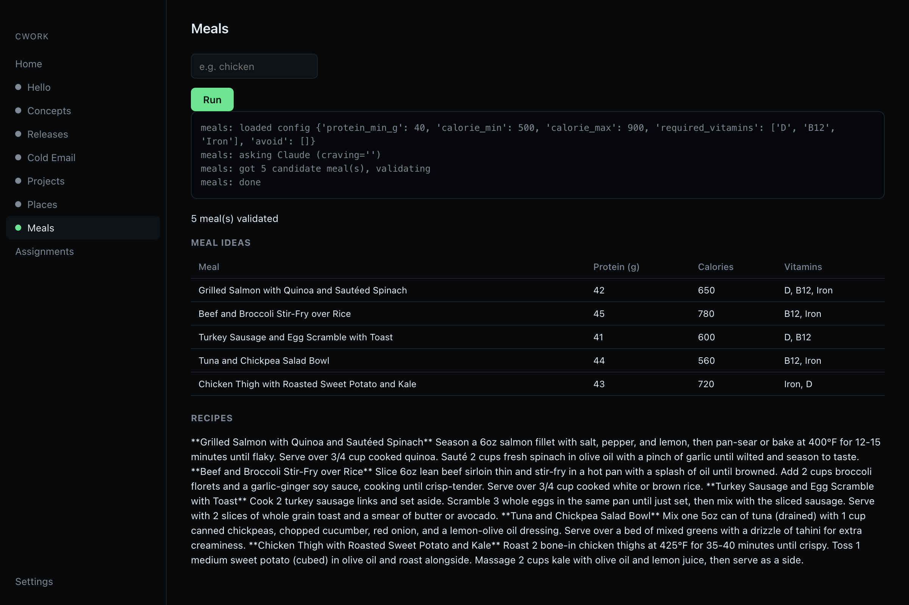

> **Part of [journey](https://github.com/dominictedrow/journey)**, Dom's ML and software portfolio.
>
> **How it was built: 🤖 vibe coded.** AI coding agents (mostly Claude Code) wrote the code. I picked the goal, made the design calls, and steered and tested the work.
>
> **When:** 2026-07 → 2026-10 · **Branch:** `vibe/c_work` · [All vibe projects](https://github.com/dominictedrow/journey/tree/vibe-projects)

# cwork

A personal automation suite: a set of Claude-powered skills that handle
recurring parts of daily life (learning digests, release watching,
place/meal search), plus a native-feeling macOS app that runs them and
displays their output. You never open a terminal to use it day to day.

Every skill is a small Python module that prints one JSON envelope; the app
has exactly one renderer that understands that envelope. Adding a skill
later means writing Python and adding one entry to a registry — no new UI
code.

## Skills

| Skill | Kind | What it does |
|---|---|---|
| `concepts` | scheduled, daily | Claude researches X/Twitter, arXiv, Hacker News, GitHub, and HuggingFace via web search, picks 2 AI + 2 software-engineering concepts worth a deep-dive, writes a brief for each. |
| `releases` | scheduled, monthly | Checks upcoming releases across categories you care about (an album, a game set, a movie, a gadget — configure your own list) via Claude web search. |
| `projects` | on-demand | Turns a named concept/model into 3-5 concrete practice projects. |
| `places` | on-demand | Natural-language query ("calm study spot") → ranked nearby places via OpenStreetMap. |
| `meals` | on-demand | Macro-constrained meal ideas + recipes, constraints enforced in Python, not just prompted. |

Plus a manual **Classes & Assignments** tracker (add/edit/delete, due-date
grouping) — plain local CRUD, no scraping, no external calls.



## Setup

Requirements: [conda](https://docs.conda.io), Node 20+, and the
[Claude Code CLI](https://claude.com/claude-code) already authenticated
(`claude` on your PATH).

```bash
conda env create -f environment.yml

npm install
npm run dev          # UI dev server
npm run electron     # in another terminal, launches the app shell
```

### Per-skill setup

- **`places`** — put your home coordinates in
  `~/Library/Application Support/cwork/config.json`:
  ```json
  { "home": { "lat": 0.0, "lon": 0.0, "label": "Your area" } }
  ```
- **`meals`** — edit `skills/meals/config.json` (protein floor, calorie
  band, required vitamins, avoid-list) to match your own targets/allergies.
- **`concepts`** — nothing to set up; Claude researches X/arXiv/HN/GitHub/HuggingFace
  itself via web search each run. (An earlier version tried reading Dom's
  personal X timeline through an authenticated Playwright session —
  abandoned once X's bot detection flagged the automated browser as "not
  secure" at the login screen, the same wall the Parker Portal spike hit.)

## Running a skill directly

```bash
python -m skills.releases                                      # scheduled skills: no args
python -m skills.places --input '{"query":"calm study spot"}'   # on-demand skills: JSON input
```

stdout is the JSON envelope; stderr is a human-readable progress log (the
app streams this live while a skill runs).

## Scheduling

Scheduled skills (`concepts`, `releases`) run via macOS `launchd`, whether
or not the app is open:

```bash
python scripts/schedule.py install     # write + load launchd agents
python scripts/schedule.py status      # launchctl list | grep com.cwork
python scripts/schedule.py uninstall   # unload + remove them
```

## Packaging

```bash
npm run dist   # vite build + electron-builder → release/mac-arm64/cwork.app + .dmg
```

Signs with a local Developer ID certificate if one is present in your
Keychain, otherwise produces an ad-hoc-signed build (Apple Silicon requires
at least that to run at all). This isn't set up for public distribution —
it's a way to get a double-clickable app on your own Mac.

## Design

Black background, blue and green accents, output-first — see `plan.md` for
the full rationale and architecture notes.
